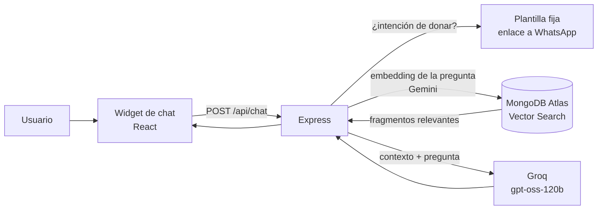

# Raíz

**Una plataforma social para la cultura y el medio ambiente.**

Raíz es un espacio digital para conectar a las personas con su comunidad, su entorno y sus raíces culturales. A través de publicaciones, foros, reuniones, colaboraciones y donaciones, busca fortalecer los lazos entre quienes quieren cuidar la cultura y el medio ambiente de su región.

🔗 **Demo en vivo:** [raiz-community.vercel.app](https://raiz-community.vercel.app/)
&nbsp;·&nbsp; 📦 **Última versión:** `v0.8.0`

> ⚠️ El backend corre en un plan gratuito: la primera carga puede tardar ~30 segundos mientras el servidor despierta.


---

## ¿Qué es Raíz?

Una red social enfocada en **cultura y medio ambiente**, donde cualquier persona mayor de 18 años puede compartir iniciativas, convocar a la comunidad o pedir apoyo para proyectos que impacten positivamente su entorno. Es gratuita, y las publicaciones se pueden ver sin crear una cuenta.

En lugar de una publicación genérica, Raíz gira en torno a **PostCultura**: una unidad de contenido flexible que se adapta a distintos tipos de participación comunitaria.

## Tipos de publicación (PostCultura)

| Tipo | Propósito |
|---|---|
| 🗣️ **Foro** | Abrir una conversación o debate sobre un tema cultural o ambiental |
| 📅 **Reunión** | Convocar a un encuentro presencial o virtual |
| 🤝 **Colaboración** | Buscar personas que se sumen a un proyecto |
| 💚 **Donación** | Solicitar apoyo económico o en especie para una causa |

Cada publicación permite un contacto directo vía **WhatsApp**, para que la organización y el apoyo pasen del espacio digital a la acción real.

## 🤖 Asistente de dudas (chatbot RAG)

Raíz incluye un asistente que resuelve dudas sobre la plataforma usando **RAG** (Retrieval-Augmented Generation): responde únicamente con información de su base de conocimiento ([`faq-raiz.md`](raiz-backend/src/features/chat/kb/faq-raiz.md)).



**Reglas de diseño**
- Responde solo con lo que está en la base de conocimiento; si no lo sabe, lo dice y ofrece contacto por WhatsApp.
- Las **donaciones y compromisos** nunca pasan por el LLM: se responde con una plantilla fija y un enlace directo a WhatsApp.
- No se guardan datos personales en logs ni en la base de vectores; el chat no usa `localStorage`.
- Validación de entrada (1–500 caracteres) y límite de 5 peticiones por minuto.
- Umbral de similitud (`RAG_MIN_SCORE = 0.85`) para descartar preguntas fuera de tema antes de llamar al LLM.

**Métricas** (20 preguntas de evaluación: 12 de FAQ, 5 fuera de tema, 3 de donación)

| Medida | Resultado |
|---|---|
| Recuperación correcta (top-1) en preguntas de FAQ | **12 / 12** |
| Similitud de preguntas del FAQ | 0.87 – 0.91 |
| Similitud de preguntas fuera de tema | 0.76 – 0.82 |
| Umbral elegido | 0.85 |
| Respuesta correcta por tipo (FAQ / fuera de tema / donación) | _completar con `npm run evaluar`_ |

**Limitaciones conocidas**
- Una pregunta dentro del tema pero sin respuesta en el FAQ puede superar el umbral (p. ej. "¿cuántos usuarios tiene Raíz?"); se mitiga con una regla del prompt, no con el umbral.
- El FAQ aún no cubre edición de perfil, creación de grupos ni recuperación de contraseña.
- Depende de las cuotas de las capas gratuitas de Groq y Gemini.

## 🏗️ Arquitectura

Organización **por funcionalidades (feature-based)** en ambos lados.

```
raiz-frontend/src/features/<feature>/   componente → hook → service
raiz-backend/src/features/<feature>/    routes → controller → service → model
```

- **Validación:** Zod como fuente de verdad de los tipos de publicación.
- **Datos:** Mongoose con *discriminators* para los cuatro tipos de PostCultura.
- **Autenticación:** JWT en cookie `httpOnly`.
- **Rutas:** React Router (`createBrowserRouter`).

## 🛠️ Stack tecnológico

| Capa | Tecnología |
|---|---|
| Frontend | React + Vite + TypeScript, Tailwind CSS v4, React Router, Zod |
| Backend | Node.js + Express + TypeScript |
| Base de datos | MongoDB Atlas (+ Atlas Vector Search) |
| IA | Groq (`openai/gpt-oss-120b`) para respuestas · Gemini (`gemini-embedding-001`) para embeddings |
| Hosting | Vercel (frontend) · Render (backend) · Atlas (base de datos) |

## 🚀 Ejecutar en local

```bash
# Backend
cd raiz-backend
cp .env.example .env      # completa las variables
npm install
npm run indexar           # indexa faq-raiz.md en Atlas (una vez, o al cambiar el FAQ)
npm run dev

# Frontend
cd raiz-frontend
npm install
npm run dev
```

**Variables de entorno (backend)**

| Variable | Descripción |
|---|---|
| `MONGO_URI` | Cadena de conexión de MongoDB Atlas |
| `JWT_SECRET` | Secreto para firmar los tokens |
| `CLIENT_URLS` | Orígenes permitidos por CORS (separados por coma) |
| `NODE_ENV` | `development` o `production` |
| `GROQ_API_KEY` / `GROQ_MODEL` | Proveedor y modelo del LLM |
| `GEMINI_API_KEY` | Embeddings |
| `WHATSAPP_CONTACTO` | Número con código de país, p. ej. `52XXXXXXXXXX` |
| `RAG_MIN_SCORE` | Umbral de similitud (recomendado `0.85`) |

**Frontend:** `VITE_API_URL` — URL del backend incluyendo `/api`.

Evaluar el chatbot: `npm run evaluar` · calibrar el umbral: `npm run calibrar`.

## 🎨 Identidad visual

Estética cálida inspirada en la tierra y la cultura local:

| Color | Hex | Uso |
|---|---|---|
| Papel | `#FBF7EE` | Fondo |
| Tinta | `#2B2318` | Texto |
| Verde | `#3D6B42` | Naturaleza y acciones principales |
| Terracota | `#C1522A` | Acentos y alertas |
| Ocre | `#D4941E` | Calidez y tradición |
| Arcilla | `#E4D4BC` | Bordes y superficies |

**Tipografía:** títulos en *Fraunces* y texto en *Inter*.

## 🗺️ Próximos pasos

- [ ] Recuperación de contraseña
- [ ] Ampliar la base de conocimiento del asistente (perfil, grupos, contraseña)
- [ ] Buscador
- [ ] Más protecciones de autenticación

## 🌍 Nuestra motivación

Raíz busca ser un puente entre las personas y las causas que les importan: desde preservar tradiciones culturales hasta impulsar acciones ambientales en su comunidad. Creemos que la tecnología puede ayudar a que las iniciativas locales encuentren a las personas correctas para crecer.

---

**Estado del proyecto:** 🚀 En producción · en desarrollo activo
